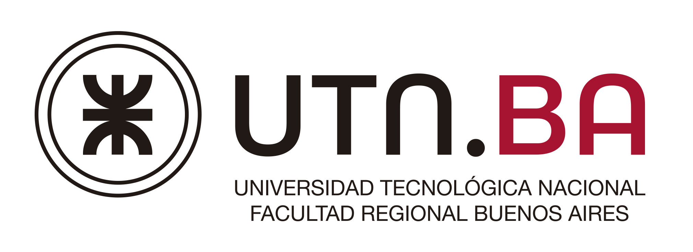

# Buffet Albert Einstein

## Índice
- [Buffet Albert Einstein](#buffet-albert-einstein)
  - [Índice](#índice)
  - [Sobre el juego](#sobre-el-juego)
    - [Capturas](#capturas)
    - [Controles](#controles)
      - [Cómo se construye, paso a paso](#cómo-se-construye-paso-a-paso)
      - [Herramientas](#herramientas)
      - [Dirección de la máquina a construir](#dirección-de-la-máquina-a-construir)
      - [Menú de máquinas](#menú-de-máquinas)
      - [Simulación](#simulación)
      - [Niveles](#niveles)
      - [Libro de recetas y portada](#libro-de-recetas-y-portada)
  - [Equipo de Desarrollo](#equipo-de-desarrollo)
  - [Licencia](#licencia)
    - [Alcance](#alcance)

## Sobre el juego
La UTN quiere modernizar el buffet con un sistema automatizado de última generación controlado por IA.
El objetivo es ambicioso: *agilizar los tiempos de los pedidos y optimizar la cocina*. Lo que los directivos y estudiantes hambrientos no saben, es que detrás de los algoritmos estás **vos**: un estudiante de ingeniería en sistemas que no tiene la más mínima idea de cómo freír una un huevo ni prender un horno.

En este juego de puzles y automatización, tu misión es diseñar la línea de producción perfecta para salvar el almuerzo de toda la facultad antes de que se arme revuelo en el buffet.

¿Qué desafíos te esperan?
- **Ingeniería de cocina (sin saber cocinar):** Aprendé recetas caóticas, combiná ingredientes y configurá cintas transportadoras, brazos mecánicos y electrodomésticos.

- **Optimización de recursos:** Vas a tener que ajustar milimétricamente el consumo eléctrico para no hacer saltar la térmica de la facultad, mientras mantenés altos estándares de calidad (y evitás que todo termine carbonizado).

- **Caos en hora pico:** Superá obstáculos, fallas técnicas y la presión constante de la marea de estudiantes esperando su comida a la salida de cursada.

*¿Podrás automatizar el desastre, o la inteligencia artificial (artificial de verdad) va a colapsar el buffet?*

### Capturas

### Controles

El juego se maneja con el mouse y el teclado. La idea básica: **elegís una herramienta con el teclado y la usás con un click sobre el tablero**.

#### Cómo se construye, paso a paso
1. Elegí una **máquina** en el menú de la derecha con un click.
2. Elegí la **dirección** hacia donde va a mirar (<kbd>W</kbd> <kbd>A</kbd> <kbd>S</kbd> <kbd>D</kbd>).
3. Apretá <kbd>Z</kbd> (herramienta Construir) y hacé click en el tablero, en la celda donde la querés.
4. Para cambiarle algo a una máquina ya puesta, usá las otras herramientas (abajo).
5. Cuando esté todo armado, apretá <kbd>Espacio</kbd> para **prender la simulación** y mirá cómo trabaja sola.

> [!NOTE]
> Volver a apretar la tecla de la herramienta elegida la deselecciona. El juego arranca sin ninguna herramienta elegida.

> [!IMPORTANT]
> Con la simulación prendida **las herramientas no funcionan sobre el tablero** (no se puede construir, editar, rotar ni borrar): apagala con <kbd>Espacio</kbd> para seguir armando.

#### Herramientas
Se eligen con la tecla y se usan con un **click izquierdo** sobre la máquina o la celda.

| Tecla | Herramienta | Qué hace al hacer click en el tablero |
|:---:|---|---|
| <kbd>Z</kbd> | **Construir** | Coloca la máquina elegida en el menú, mirando hacia la dirección elegida |
| <kbd>X</kbd> | **Editar** | Abre en el menú de la derecha los ajustes de la máquina clickeada (ingrediente, velocidad, receta, filtros) |
| <kbd>C</kbd> | **Rotar** | Gira la máquina clickeada 90° en sentido horario |
| <kbd>V</kbd> | **Borrar** | Quita la máquina clickeada (y los ingredientes que tenga adentro) |

#### Dirección de la máquina a construir
Define hacia dónde mira la **próxima** máquina que construyas.

| Tecla | Dirección |
|:---:|---|
| <kbd>W</kbd> | Arriba |
| <kbd>A</kbd> | Izquierda |
| <kbd>S</kbd> | Abajo |
| <kbd>D</kbd> | Derecha |

#### Menú de máquinas
| Tecla | Acción |
|:---:|---|
| <kbd>Q</kbd> | Página anterior del menú de máquinas |
| <kbd>E</kbd> | Página siguiente del menú de máquinas |

#### Simulación
| Tecla | Acción |
|:---:|---|
| <kbd>Espacio</kbd> o <kbd>5</kbd> | Prender / apagar la simulación. Al apagarla vuelven a cero los ingredientes y el progreso del nivel |
| <kbd>1</kbd> | Velocidad normal (x1) |
| <kbd>2</kbd> | Velocidad rápida (x2) |
| <kbd>3</kbd> | Velocidad muy rápida (x3) |

#### Niveles
| Tecla | Acción |
|:---:|---|
| <kbd>Enter</kbd> | En un tutorial, seguir después de una explicación |
| <kbd>T</kbd> | Saltear los tutoriales e ir al nivel 1 (también se puede con el botón SALTEAR TUTORIAL, haciendo click) |
| <kbd>N</kbd> | Pasar al nivel siguiente (solo después de ganar el actual) |
| <kbd>0</kbd> | Reiniciar el nivel (borra también lo que construiste) |
| <kbd>L</kbd> | Ir al modo libre (todas las máquinas, sin objetivo). Volver a apretarla te lleva al nivel que te toca jugar. No funciona con la simulación prendida |

#### Libro de recetas y portada
| Tecla | Acción |
|:---:|---|
| <kbd>F</kbd> | Abrir / cerrar el libro de recetas. Mientras está abierto, la simulación queda en pausa |
| <kbd>←</kbd> <kbd>→</kbd> | Pasar las páginas del libro de recetas |
| <kbd>M</kbd> | Volver a la portada |

En la **portada**: <kbd>Enter</kbd> empieza a jugar, <kbd>I</kbd> muestra los controles dentro del juego y <kbd>S</kbd> cierra el juego.

## Equipo de Desarrollo
Proyecto desarrollado en el marco de la materia **Paradigmas de Programación** por estudiantes de Ingeniería en Sistemas de la **UTN FRBA**:

- Bustos, Mateo
- Chambi Flores, Carlos Aramis
- Ramounat, Facundo
- Scalise Giussani, Federico
- Silva, Mateo

 

  

## Licencia

Buffet Albert Einstein  
Copyright (C) 2026  grupo objeTOMs (Mateo Bustos, Carlos Aramis Chambi Flores, Facundo Ramounat, Federico Scalise Giussani, Mateo Silva)

Este programa es software libre: puede redistribuirse y modificarse bajo los términos de la Licencia Pública General de GNU, publicada por la Free Software Foundation, ya sea la versión 3 de la Licencia o, a elección, cualquier versión posterior.

Este programa se distribuye con la esperanza de que sea útil, pero SIN NINGUNA GARANTÍA, incluso sin la garantía implícita de COMERCIABILIDAD o IDONEIDAD PARA UN PROPÓSITO PARTICULAR. Véase la Licencia Pública General de GNU para más detalles.

El texto completo de la licencia se encuentra en el archivo [LICENSE](LICENSE) y en <https://www.gnu.org/licenses/>.

### Alcance

**Amparado por la licencia:**
- El código fuente en Wollok: `src/` (archivos `.wlk` y `.wpgm`) y `test/` (archivos `.wtest`). Es obra original del grupo objeTOMs y no incorpora código de terceros.
- Los scripts de Python ubicados en `assets/` (`gifToFrames.py`, `assetRotate.py`, `svgToSprite.py`, `makeKeyHints.py`, `makeLevelInfo.py` y `makeFont.py`). No forman parte del juego: son herramientas auxiliares para crear sprites e imágenes, y no se utilizan al jugar. No incorporan código de terceros.
- Los recursos de `assets/` (imágenes, GIFs y música). Son obra original del grupo objeTOMs: la música fue compuesta por el grupo y las imágenes fueron creadas por el grupo.
- La documentación del repositorio (archivos `README.md`).

**No amparado por la licencia:**
- Las dependencias externas de los scripts de Python, que no se distribuyen con este repositorio y se rigen por sus propias licencias: la biblioteca Pillow (licencia HPND), un navegador (Edge, Chrome o Chromium) y las tipografías Segoe UI Bold y Rockwell Extra Bold, propiedad de sus fabricantes, con las cuales se dibujaron las imágenes de letras y teclas del menú.
