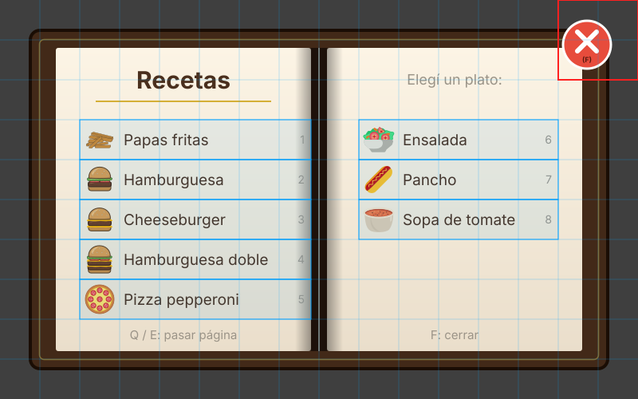

# Plan de implementación: libro de recetas

Un libro que el jugador abre para ver cómo se arma cada plato. Se abre con un icono abajo a la derecha del tablero o con la tecla **F**. Mientras está abierto, la simulación queda en pausa. Primero muestra un **índice**; al elegir una receta, la imagen se reemplaza por la **página de esa receta**, del mismo tamaño y forma. Se cierra con la cruz roja de arriba a la derecha o con **F**.

> [!IMPORTANT]
> **Cómo quedó después de traer `master`:** el código es el de este plan, pero **sin índice**, como el libro que tenía `master`: se abre en la última receta vista y se pasa de una a otra con las **flechas** (izquierda y derecha), no con Q y E. También se abre desde la portada. Son 10 recetas: las 8 dibujadas para este plan, más la tostada y el desayuno, que se pasaron de las páginas de `master` (1250x800) a 800x500. Lo que sigue sobre el índice y Q/E quedó como historia.

> [!TIP]
> **Cómo usar este archivo**
> - Al terminar una fase, tacharla en el [estado general](#estado-general) en el mismo commit que la termina.
> - Lo que está en [Decisiones](#decisiones) ya tiene una opción por defecto. Si el equipo elige otra, se cambia acá **antes** de programarlo.

## Estado general

- [x] [Fase 0: Las imágenes](#fase-0-las-imágenes) (las páginas, dibujadas; el índice y el icono los genera `assets/recipes_book/makeIndex.py` a partir de ellas)
- [x] [Fase 1: Pausa en `simulationEngine`](#fase-1-pausa-en-simulationengine)
- [x] [Fase 2: `recipeBook`](#fase-2-recipebook)
- [x] [Fase 3: Entrada: la tecla F, los clicks y el bloqueo](#fase-3-entrada-la-tecla-f-los-clicks-y-el-bloqueo)
- [x] [Fase 4: Tests y documentación](#fase-4-tests-y-documentación)

## La idea

- **El libro es un panel más, como `levelInfoMenu`:** un objeto en `src/menu/` que dibuja y responde clicks. No sabe de niveles ni de máquinas.
- **Cada página es una imagen entera.** El código no dibuja textos ni ingredientes: pone una imagen y sabe qué celdas de esa imagen se pueden clickear.
- **Los clicks de Wollok llegan por celda** (50x50 px), no por píxel. Lo único que tiene que respetar el dibujo es que **lo clickeable ocupe celdas enteras** (o un grupo de celdas): el resto se puede dibujar libre.
- **Una página es un plato, no una receta del ensamblador.** Las papas fritas no pasan por el ensamblador, pero tienen página (la de la referencia). Por eso las páginas son una lista propia del libro, y un test revisa que al menos estén todas las recetas del ensamblador.
- **Pausar no es apagar.** Apagar la simulación (tecla 5) borra los items. El libro necesita congelarla y después seguir donde estaba: es un estado nuevo del engine.

---

## Fase 0: Las imágenes

Todas en `assets/recipes_book/`, en PNG: el icono (`icon.png`), el índice (`index.png`) y una página por plato (`recipe_<plato>.png`). Lo de afuera del libro, como en la referencia, es **negro al 75% de opacidad**: así, al abrir el libro, el tablero de atrás se ve oscurecido.

### El icono: `icon.png` (50x50)

- Un libro con una **F** visible.
- Va en la celda **(20, 0)**: abajo de todo, en la columna de la izquierda del (+) (que está en la (21, 15)). Esa celda está sobre la esquina del marco del tablero, así que conviene que el icono tenga su propio fondo o borde.

### Las páginas: 800x500 (16x10 celdas), igual que la referencia

Todas las imágenes del libro (el índice y cada receta) miden **800x500** y tienen la misma forma: el libro abierto con dos hojas y la cruz.

Se dibujan desde la celda **(5, 2)**: Wollok pone la esquina de abajo a la izquierda de la imagen en esa celda, y la imagen crece hacia arriba y a la derecha. Así ocupa las celdas x 5 a 20 e y 2 a 11: tapa casi todo el tablero y deja a la vista la info del nivel y la barra de herramientas.

Sobre la referencia, con la grilla de 50 px (columnas 0 a 15 de izquierda a derecha, filas 0 a 9 de arriba hacia abajo):

```
 px →     0    50   100  150  200  250  300  350  400  450  500  550  600  650  700  750  800
 fila 0   ·    ·    ·    ·    ·    ·    ·    ·    ·    ·    ·    ·    ·    ·  [ X    X ]
 fila 1   ·  ┌─ hoja izquierda ──────────────┐ ┌─ hoja derecha ───────────────┐[ X    X ]
 fila 2   ·  │    col 2 a 7 (100-400 px)     │ │   col 9 a 13 (450-700 px)    │   ·
  ...        │                               │ │                              │
 fila 8   ·  └───────────────────────────────┘ └──────────────────────────────┘   ·
 fila 9   ·    ·    ·    ·    ·    ·    ·    ·    ·    ·    ·    ·    ·    ·    ·    ·
```

- **La cruz** ocupa las columnas 14 y 15 y las filas 0 y 1 (los píxeles 700 a 800 y 0 a 100). En la referencia el círculo rojo cae justo ahí, así que **no hay que moverla**: el código toma esas **4 celdas** como el botón de cerrar. Tiene que estar en el mismo lugar en todas las páginas.
- La hoja izquierda va de los píxeles 70 a 390, y la derecha de 410 a 730.

### Una página por plato: `<plato>.png`

Como la referencia de las papas fritas. Lo que conviene que tenga cada una:

| Qué | Dónde | Notas |
|---|---|---|
| El nombre del plato | Hoja izquierda, arriba | |
| Los ingredientes | Hoja izquierda | Con las imágenes del juego (`assets/food/Ingredients`) y la cantidad |
| La línea de producción | Hoja derecha | Las máquinas en orden, con las imágenes del juego. Para un plato del ensamblador, que termine en el ensamblador y diga que hay que **elegir la receta** con X |
| El número de página | Abajo a la derecha (`1/8`) | No se clickea |
| La cruz | Columnas 14-15, filas 0-1 | Igual en todas |

- **La página muestra cómo se arma el plato, no cómo se mueven los ingredientes:** las máquinas que lo transforman, sin cintas ni brazos (los brazos los enseña el tutorial).
- Los datos de abajo de la hoja derecha (rendimiento, tiempo, valor nutricional) son **de relleno**: el juego no los usa.

> [!IMPORTANT]
> El **queso feta** (hamburguesas) pasa **dos veces** por la cortadora; el **queso cortado** (pizza), una sola. Conviene que la página lo muestre.

Lo que tiene que decir cada plato del ensamblador (sale de `src/food/recipes.wlk` y `foodTypes.wlk`):

| Archivo | Plato | Ingredientes |
|---|---|---|
| `friedPotato.png` | Papas fritas | 1 papa → cortadora → freidora. **No usa ensamblador** |
| `burger.png` | Hamburguesa | 1 pan cortado (pan → cortadora), 1 lechuga cortada (cortadora), 1 tomate cortado (cortadora), 1 carne cocida (carne → horno) |
| `cheeseBurger.png` | Cheeseburger | 1 pan cortado, 1 carne cocida, **2** quesos feta (queso → cortadora → **cortadora otra vez**) |
| `doubleBurger.png` | Hamburguesa doble | 1 pan cortado, 1 lechuga cortada, 1 tomate cortado, **2** carnes cocidas, **2** quesos feta |
| `pizzaPepperoni.png` | Pizza pepperoni | 1 masa cocida (masa → horno), 1 queso cortado (queso → cortadora, **una** vez), 1 salame cortado (cortadora) |
| `salad.png` | Ensalada | 1 tomate cortado, 1 lechuga cortada |
| `hotDog.png` | Pancho | 1 pan cortado, 1 salchicha cocida (salchicha → horno) |
| `tomatoSoup.png` | Sopa de tomate | **2** tomates cortados |

Son 8, así que el número de página va de `1/8` a `8/8` (la referencia dice `1/10`). En el índice entran hasta 10: quedan dos lugares en la hoja derecha para platos nuevos.

### El índice: `index.png`

**Mismo tamaño, forma y cruz** que las páginas. Entran **hasta 10 platos: 5 por hoja**, uno por fila de celdas. Hoy son 8: 5 en la hoja izquierda y 3 en la derecha (las filas 6 y 7 de la derecha quedan vacías y no se clickean).

| Qué | Columnas (px) | Filas (px) | Celdas del juego |
|---|---|---|---|
| Título ("Recetas") | Hoja izquierda | Fila 1 (50-100) y 2 (100-150) | No se clickea |
| Platos 1 a 5 | **2 a 7** (100-400) | **3 a 7** (150-400), uno por fila | x 7 a 12; y 8 (el 1) a 4 (el 5) |
| Platos 6 a 10 | **9 a 13** (450-700) | **3 a 7** (150-400), uno por fila | x 14 a 18; y 8 (el 6) a 4 (el 10) |
| Ayuda ("Q / E: pasar página") | Cualquiera | Fila 8 (400-450) | No se clickea |
| La cruz | 14 y 15 (700-800) | 0 y 1 (0-100) | x 19 y 20; y 10 y 11 |

- **Cada plato ocupa una fila entera de su hoja:** todo ese rectángulo de 50 px de alto se clickea. Una imagen chica del plato (40 px) y el nombre entran justo. Conviene una línea fina entre filas para que se vea dónde termina cada una.
- El orden del índice es el orden de las páginas (el número de página): el plato de la fila 3 de la hoja izquierda es la página 1.
- Para pasar de un píxel de la imagen a la celda del juego: **x = 5 + columna**, **y = 11 − fila**.

#### Dónde va cada texto del índice



**Para Figma: `docs/images/libro-indice.svg`.** Es el índice entero en capas editables: el libro (`libro`), los textos (`indice`, con un grupo por plato: su imagen, su nombre y su número), la cruz (`cruz`) y una capa **`GUIA-borrar-antes-de-exportar`** con la grilla de 50 px, las filas que se clickean (azul) y la zona de la cruz (rojo). Esa última capa **no va en la imagen final**: hay que borrarla u ocultarla antes de exportar el PNG. Las imágenes de los platos son los mismos SVG del juego (`assets/food/Dishes` y, para las papas fritas, `Ingredients/potatoes/potato_cooked.svg`), metidos como vectores. Para agregar un plato en Figma: duplicar el grupo de otro plato, bajarlo 50 px a la fila siguiente y cambiarle la imagen, el nombre y el número.

(`docs/images/libro-indice-guia.png` es lo mismo en PNG, sobre la referencia.)

Los píxeles son de la imagen de 800x500, contando desde arriba a la izquierda. "Centro" quiere decir que el texto se centra en ese punto.

| Texto | Posición (px) | Alineación | Tamaño |
|---|---|---|---|
| Título "Recetas" | x 230, y 100 | Centro (el centro de la hoja izquierda, a la misma altura que el título de las páginas) | Como "Papas Fritas" de la referencia (~30 px, negrita) |
| La línea dorada debajo del título | x 120 a 340, y 127 | | |
| Subtítulo "Elegí un plato:" | x 570, y 100 | Centro (el de la hoja derecha, como "Línea de producción:") | ~18 px |
| Plato de la fila *n* (n = 0 a 4) | Fila: **y = 150 + 50·n a 200 + 50·n**. Hoja izquierda: **x 100 a 390**. Hoja derecha: **x 450 a 700** | | |
| ↳ Imagen del plato | 40x40, a 5 px del borde izquierdo y del de arriba de la fila (izquierda: x 105, derecha: x 455) | | La de `assets/food/Dishes` achicada |
| ↳ Nombre | x 155 (izquierda) o 505 (derecha), en el **medio de la fila** (y = 175 + 50·n) | A la izquierda, centrado en vertical | ~19 px. Que no pase de x 360 (izquierda) o 670 (derecha), para dejar lugar al número |
| ↳ Número de página (opcional) | x 382 (izquierda) o 692 (derecha), en el medio de la fila | A la derecha | ~14 px, gris |
| Líneas entre platos | y = 200, 250, 300, 350 (y 150 y 400 de borde), de x 100 a 390 y de 450 a 700 | | Finas: que se vea dónde termina cada fila |
| Ayuda "Q / E: pasar página" | x 230, y 420 | Centro | ~15 px, gris |
| Ayuda "F: cerrar" | x 570, y 420 | Centro | ~15 px, gris |

> [!WARNING]
> **Lo importante es que cada plato quede dentro de su rectángulo azul.** El juego decide qué plato se eligió por la celda del click. Si el nombre de un plato se corre a la fila de al lado, el jugador va a clickear sobre un plato y se va a abrir otro.

- **Hoja derecha, columnas 400 a 450:** ahí está el lomo, así que esa columna no se clickea. Los platos de la derecha empiezan en x 450, 40 px después del borde de la hoja: conviene dejar ese margen vacío.
- **Arriba a la derecha (x 700 a 800, y 0 a 100)** es la cruz: nada de texto ahí, tampoco en las páginas de los platos.
- **Páginas de los platos:** salvo la cruz, no tienen nada que se clickee, así que el texto va donde quede mejor. Para que el índice y las páginas se vean iguales, conviene que el título de las dos quede a la misma altura (y 100).

### Mientras no estén las imágenes

Se puede programar todo con imágenes provisorias de 800x500 (un rectángulo con el nombre escrito y la cruz en su lugar). Para el código sólo importan **el tamaño y las celdas clickeables**.

---

## Fase 1: Pausa en `simulationEngine`

**Para qué:** congelar la simulación sin perder nada. Apagarla (`stop`) borra los items, y el libro no tiene que hacer eso.

```wollok
// Pausada: prendida, pero sin correr pasos (ver el libro de recetas). No es lo mismo que apagada:
// los items y la agenda quedan como estaban, y al seguir continúa desde ahí.
var property paused = false

method tick() {
	if (running && !paused) speed.times({ _ => self.step() })
}

method pause() { paused = true }
method resume() { paused = false }
```

- `stop()` y `reset()` ponen `paused = false`, para que apagar o cargar un nivel nunca deje la simulación trabada.
- `step()` **no** mira `paused`: los tests lo siguen usando para avanzar a mano.
- Las animaciones de los items se congelan solas (avanzan dentro de `step`). Los GIF de las máquinas (cintas, horno) siguen moviéndose porque los anima el navegador; las que quedan fuera del libro se van a ver moverse.

**Listo cuando:** con la simulación prendida y en pausa, `tick()` no ejecuta nada de la agenda; al seguir, se ejecuta lo pendiente.

---

## Fase 2: `recipeBook`

Archivo nuevo: `src/menu/recipeBook.wlk`.

```wollok
import wollok.game.*
import cellPosition.*
import food.foodTypes.*
import simulation.simulationEngine.*

// El libro de recetas: un índice y una página por plato (las imágenes están en assets/recipeBook/).
// Se abre con el icono o con F, pausa la simulación mientras está abierto, y se cierra con la cruz o con F.
// Todas las imágenes miden 800x500 y se dibujan desde bookOrigin. Lo clickeable ocupa celdas enteras.
object recipeBook {
	// La celda del icono: abajo de todo, en la columna de la izquierda del (+)
	const property iconCell = new CellPosition(x = 20, y = 0)
	// Dónde se dibuja el libro (abajo a la izquierda de la imagen)
	const bookOrigin = new CellPosition(x = 5, y = 2)

	// Las páginas, en orden (el número de página). Los 5 primeros van en la hoja izquierda del índice.
	const pages = [
		new BookPage(dish = friedPotato, image = "recipes_book/friedPotato.png"),
		new BookPage(dish = burger, image = "recipes_book/burger.png"),
		...
	]

	var open = false
	// null: se ve el índice. Si no, el número de la página que se ve (0 es la primera).
	var pageIndex = null
	// Si la pausa la puso el libro (para no prender una simulación que estaba apagada al cerrar)
	var pausedByBook = false
	const sprite = new RecipeBookVisual(position = bookOrigin)

	method isOpen() = open
	method pages() = pages
	method showingIndex() = pageIndex == null

	method setUp() { game.addVisual(bookIcon) }

	method toggle() { if (open) self.close() else self.open() }

	method open() {
		if (!open) {
			open = true
			pausedByBook = simulationEngine.running() && !simulationEngine.paused()
			if (pausedByBook) simulationEngine.pause()
			self.showIndex()
			game.addVisual(sprite)     // último: queda arriba de todo
		}
	}

	method close() {
		if (open) {
			open = false
			game.removeVisual(sprite)
			if (pausedByBook) simulationEngine.resume()
			pausedByBook = false
		}
	}

	method showIndex() {
		pageIndex = null
		sprite.image("recipes_book/index.png")
	}

	method showPage(index) {
		pageIndex = index
		sprite.image(pages.get(index).image())
	}

	// Q / E: la página anterior o la siguiente. El índice está antes de la primera.
	method prevPage() {
		if (pageIndex == 0) self.showIndex()
		else if (!self.showingIndex()) self.showPage(pageIndex - 1)
	}
	method nextPage() {
		if (self.showingIndex()) self.showPage(0)
		else if (pageIndex < pages.size() - 1) self.showPage(pageIndex + 1)
	}

	// Lo llama userController con cualquier click mientras el libro está abierto
	method onClick(pos) {
		if (self.isClose(pos)) self.close()
		else if (self.showingIndex()) {
			const index = self.entryAt(pos)
			if (index != null) self.showPage(index)
		}
	}

	// La cruz: columnas 14-15 y filas 0-1 de la imagen
	method isClose(pos) = pos.x().between(19, 20) && pos.y().between(10, 11)

	// El número de página del plato del índice en esa celda (null si no hay ninguno).
	// Hoja izquierda: x 7 a 12, páginas 0 a 4. Hoja derecha: x 14 a 18, páginas 5 a 9. Filas: y 8 a 4.
	method entryAt(pos) {
		const row = 8 - pos.y()
		const column = if (pos.x().between(7, 12)) 0 else if (pos.x().between(14, 18)) 1 else null
		const index = if (column == null || !row.between(0, 4)) null else column * 5 + row
		return if (index == null || index >= pages.size()) null else index
	}
}

// Una página del libro: de qué plato es y su imagen
class BookPage {
	const property dish
	const property image
}

class RecipeBookVisual {
	const property position
	var property image = "recipes_book/index.png"
}

object bookIcon {
	method position() = recipeBook.iconCell()
	method image() = "recipes_book/icon.png"
}
```

- **Las páginas dicen su plato** (`dish`, un kind como `friedPotato` o `hotDog`), para el test que revisa que cada receta del ensamblador tiene página.
- **La posición de cada plato en el índice sale de su lugar en `pages`**. Los números de las celdas (7 a 12, 14 a 18, 8 a 4, 19-20 y 10-11) son los de la [fase 0](#el-índice-indexpng): si cambia el dibujo, se cambian ahí y en la tabla.
- **Navegación:** con el índice se elige un plato con un click; desde una página, **Q y E** pasan a la anterior o a la siguiente (son las mismas teclas que pasan de página en el menú de máquinas), y **Q en la primera página vuelve al índice**. Así no hace falta un botón de "volver" en el dibujo (ver [decisión 2](#decisiones)).
- `pausedByBook`: si el jugador abre el libro con la simulación apagada, al cerrarlo **sigue apagada**.
- `main.wpgm` llama a `recipeBook.setUp()` junto con `menuManager.setUp()`.
- `levelManager._clear()` llama a `recipeBook.close()`, por si algún día se carga un nivel con el libro abierto (hoy las teclas lo impiden: ver fase 3).
- Cuando haya más de 10 platos, el índice necesita una segunda imagen (`index2.png`) o dos filas más por hoja. Queda para cuando haga falta.

---

## Fase 3: Entrada: la tecla F, los clicks y el bloqueo

Todo en `userController`, que es el que traduce lo que hace el jugador.

**Clicks:**

```wollok
game.onClickDo({ pos =>
	if (recipeBook.isOpen()) recipeBook.onClick(pos)
	else if (pos.x() == recipeBook.iconCell().x() && pos.y() == recipeBook.iconCell().y()) recipeBook.open()
	else toolsManager.onClick(pos)
})
```

**Teclas:**

- **F:** `startMenu.toggleRecipeBook()`.
- **Q y E:** con el libro abierto pasan las páginas del libro; si no, las del menú de máquinas, como hoy.
- **Todas las demás no hacen nada mientras el libro está abierto** (si no, se podría, por ejemplo, apagar la simulación con 5 o reiniciar el nivel con 0 debajo del libro). En vez de repetir el `if` en cada tecla, un método:

```wollok
// Ejecuta la acción sólo si el libro de recetas está cerrado
method unlessBookOpen(action) { if (!recipeBook.isOpen()) action.apply() }

keyboard.num5().onPressDo({ => self.unlessBookOpen({ levelManager.toggleSimulation() }) })
keyboard.q().onPressDo({ => if (recipeBook.isOpen()) recipeBook.prevPage() else menuManager.prevPage() })
```

**Listo cuando:** con el libro abierto, clickear el tablero no coloca nada y las teclas no hacen nada, salvo F, Q y E.

---

## Fase 4: Tests y documentación

**Tests** (`test/recipeBookTest.wtest`, nuevo):

- Abrir el libro muestra el índice; clickear la fila de un plato muestra su página; clickear cualquiera de las 4 celdas de la cruz lo cierra.
- Las celdas del índice: la primera fila de la hoja izquierda es la página 0, la primera de la derecha la 5, y una celda fuera de las hojas no elige nada.
- Q y E: desde el índice, E va a la primera página; Q en la primera vuelve al índice; E en la última no hace nada.
- Abrir con la simulación prendida la pausa (una acción agendada no corre con `tick()`); cerrarlo la sigue, y lo agendado corre.
- Abrir y cerrar con la simulación apagada la deja apagada.
- F abre y cierra.
- Con el libro abierto, un click en el tablero no coloca una máquina.
- **Cada receta de `recipeBook.all()` tiene una página con su plato** (`recipe.result()`). Así, quien agregue una receta se entera de que falta su página.
- No hay más de 10 páginas (lo que entra en el índice).
- Apagar la simulación (o cargar un nivel) estando en pausa deja `paused` en `false`.

**Documentación:**

- `src/menu/README.md`: `recipeBook`, la grilla de las imágenes y cómo agregar un plato.
- `src/simulation/README.md`: la diferencia entre apagada y en pausa.
- `src/input/README.md` y el README principal: la tecla **F**, el icono, y Q/E dentro del libro.
- `assets/README.md`: el tamaño y la grilla de las imágenes del libro (las tablas de la fase 0).

---

## Decisiones

Cada una ya tiene una opción por defecto, que es la que sigue el plan.

1. **¿El índice muestra todos los platos o sólo los del nivel?** Por defecto, **todos**: el índice es una imagen fija, y el libro sirve también para aprender recetas que vienen después. Para mostrar sólo los del nivel habría que dibujar cada fila por separado (una imagen por fila) en vez de un índice entero.
2. **¿Cómo se vuelve al índice desde una página?** Por defecto, **con Q desde la primera página** (y Q/E para pasar de una a otra), así el dibujo no cambia. La alternativa es dibujar un botón "Índice" en las páginas (por ejemplo, en la fila 9, abajo a la izquierda, que hoy está libre), que ocuparía celdas enteras como la cruz.
3. **¿Dónde va el libro?** Por defecto, desde la celda **(5, 2)**: ocupa x 5 a 20 e y 2 a 11. Mide 16 celdas de ancho y el tablero 15, así que se pasa una celda sobre el marco derecho, sin llegar a la barra de herramientas. Quedan visibles las filas 1, 12 y 13 del tablero.
4. **¿Páginas dibujadas o armadas por el código?** Por defecto, **dibujadas** (una imagen por plato), como la referencia. La alternativa es que el código arme la página con los datos de la receta: no hay que dibujar nada al agregar una receta, pero queda menos lindo y es más código.
